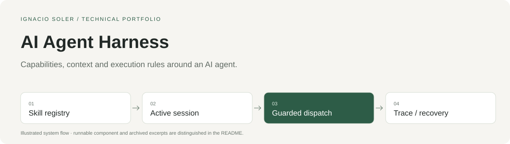

# AI Agent Harness

Capabilities, context and execution rules around an AI agent.

[Watch the agent](#watch-the-agent) · [Run the sample](#run-the-sample) · [Architecture](docs/architecture.md) · [Design decisions](docs/decisions.md) · [Code tour](docs/code-tour.md) · [Español](docs/LEEME.md)

## Watch the agent

**Chals AI — AI Assistant for Google Sheets.** See the assistant inside the spreadsheet interface. The local Python sample below focuses on prompt-cache key construction.

[](https://www.youtube.com/watch?v=Oo4Bd8iGeUY)

[Watch on YouTube](https://www.youtube.com/watch?v=Oo4Bd8iGeUY) · [Media provenance](docs/demos/manifest.json).



## The project

An agent needs a stable execution boundary: which tools are available, which capability owns them, what happens when a call fails, how much context can be sent and how execution survives retries.

**My work.** I assembled the agent and its skill session, registry and dispatch surface, with capability gates, concrete tool contracts, loop recovery, context-budget handling, prompt-cache options and durable run events. I led the product and technical construction, using AI-assisted development alongside integration and verification.

**Period.** May–July 2026; historical product harness.

**Project outcome.** A harness implemented as part of Chals AI. This sample establishes selected component behavior; it does not establish complete acceptance in every agent host.

## What you can inspect here

The executable sample checks the original local prompt-cache key builder. Skill loading, tool dispatch, budget management and event persistence are documented excerpts, not an independently bootable agent in this repository.

| Entry | What to look at |
|---|---|
| [prompt_cache.py](source/prompt_cache.py) | Original executable component |
| [demo.py](demo.py) | Synthetic fixtures and 5 checked behaviors |
| [Architecture](docs/architecture.md) | The wider system and the sample boundary |
| [Design decisions](docs/decisions.md) | Tradeoffs with source links |
| [Code tour](docs/code-tour.md) | 8 selected excerpts from the wider construction |
| [Provenance](provenance.json) | Original paths, commits, hashes and documented redactions |

## Run the sample

Requires **Python 3.10+**, with no package installation or account setup.

```sh
git clone https://github.com/nasoler123/ai-agent-harness.git
cd ai-agent-harness
python3 -I demo.py
python3 verify.py
```

The sample runs offline with synthetic data; it rejects socket operations and external subprocesses. `verify.py` checks the result receipt, source hash, local links, instruction parity and credential patterns. These checks cover the published sample rather than the full production system.

Expected observations:

- Repeated inputs and the same skill set in a different order keep the same key.
- Changing capabilities, channel or prompt content changes the key.
- The demo makes no model request and does not measure cache hit rate.

[Recorded local results](verification.json).

## Stack in context

Python · OpenAI Agents SDK · skills / tools · prompt caching · Firestore · Cloud Tasks.

The stack describes the wider construction. The executable sample uses Python's standard library; the remaining integrations appear in the code tour.

## Related work

This case belongs to the evolution of **Chals AI**, from document automation and a financial product to agent tooling and managed data infrastructure. The cases overlap; they are not four separate companies.

[Invoice Automation](https://github.com/nasoler123/invoice-automation) · [Financial Modeling SaaS](https://github.com/nasoler123/financial-modeling-saas) · [Data Platform and MCP](https://github.com/nasoler123/data-platform-mcp)

[Ignacio Soler](https://github.com/nasoler123) · [LinkedIn](https://www.linkedin.com/in/ignacio-soler-esteban/)
